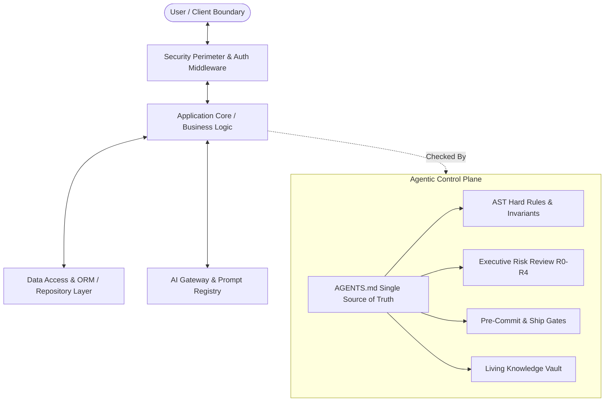

# System Architecture

Hub index: [[_START-HERE]].

This document outlines the core architecture and design topology for products developed with this template.

## Architectural Layers

1. **Client / Presentation Layer:**
   - Server-first components with interactive leaves at the UI boundary.
   - Design token discipline: all styling derives from tokens, never arbitrary raw values.
   - Accessible by default (WCAG 2.2 AA).

2. **Application Core (`src/`):**
   - Strictly typed TypeScript modules (target <= 400 lines per module).
   - Validation at every external boundary using Zod or equivalent declarative schemas.
   - Fail-closed error envelopes.

3. **Data Access Layer:**
   - Explicit queries, tenant/ownership isolation on all tables.
   - Deterministic migrations.
   - All list queries bounded with pagination.

4. **AI Pipelines & Model Gateway:**
   - Prompts live exclusively in versioned registries.
   - Untrusted inputs escaped and delimited.
   - Model gateway manages rate limits, fallbacks, and cost ceilings.

5. **Security & Anti-Regression Perimeter:**
   - Commit and push hooks verify secret boundaries and code invariants before code leaves the developer machine.
   - Every regression is recorded in [[_Lessons]] with an automated machine gate that prevents recurrence.

## Related ADRs & Conventions

- Architectural Decisions: [[Decisions]]
- Engineering Conventions: [[Conventions]]
- Current Implementation Status: [[Active-Context]]
